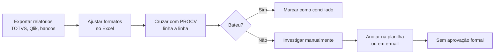
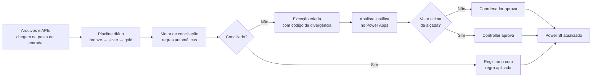
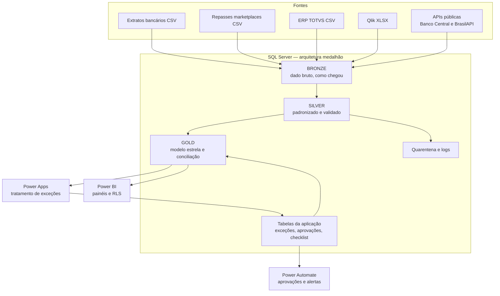

# Fecha360 — Documento de Requisitos

**Plataforma de Fechamento Mensal e Conciliação Financeira**

| Campo | Valor |
|---|---|
| Código do documento | DOC-REQ-001 |
| Versão | 0.1 |
| Status | Rascunho — em revisão |
| Autor | Leandro Veiga |
| Data de criação | 20/11/2026 |
| Classificação | Interno — projeto de portfólio |
| Documentos relacionados | DOC-ARQ-002 Documento de Arquitetura (a elaborar) · DOC-DIC-003 Dicionário de Dados (a elaborar) |

### Histórico de revisões

| Versão | Data | Autor | Descrição da alteração |
|---|---|---|---|
| 0.1 | 20/11/2026 | Leandro Veiga | Versão inicial: contexto, escopo, requisitos, regras de negócio e KPIs |

> **Aviso:** este é um projeto de portfólio. A empresa, os CNPJs, os clientes e todos os valores são **fictícios**. O processo descrito foi modelado a partir de experiência profissional real com conciliação financeira em e-commerce e marketplace, sem uso de qualquer dado ou informação confidencial de empregadores.

---

## Sumário

1. [Sumário executivo](#1-sumário-executivo)
2. [Contexto e problema](#2-contexto-e-problema)
3. [Objetivos e métricas de sucesso](#3-objetivos-e-métricas-de-sucesso)
4. [Escopo](#4-escopo)
5. [Partes interessadas e perfis de usuário](#5-partes-interessadas-e-perfis-de-usuário)
6. [Processo atual (AS-IS) e processo futuro (TO-BE)](#6-processo-atual-as-is-e-processo-futuro-to-be)
7. [Inventário de fontes de dados](#7-inventário-de-fontes-de-dados)
8. [Requisitos funcionais](#8-requisitos-funcionais)
9. [Regras de negócio](#9-regras-de-negócio)
10. [Catálogo de divergências](#10-catálogo-de-divergências)
11. [Indicadores (KPIs)](#11-indicadores-kpis)
12. [Requisitos não funcionais](#12-requisitos-não-funcionais)
13. [Segurança e matriz de acesso](#13-segurança-e-matriz-de-acesso)
14. [Governança e qualidade de dados](#14-governança-e-qualidade-de-dados)
15. [Visão conceitual da solução](#15-visão-conceitual-da-solução)
16. [Premissas, restrições e riscos](#16-premissas-restrições-e-riscos)
17. [Critérios de aceite do MVP](#17-critérios-de-aceite-do-mvp)
18. [Glossário](#18-glossário)
19. [Aprovações](#19-aprovações)

---

## 1. Sumário executivo

A empresa fictícia **Atlas Comércio Group** opera em dois negócios: **e-commerce e marketplace** (Atlas Digital Ltda.) e **distribuição B2B** (Atlas Distribuição Ltda.). Hoje, a conciliação entre o que os bancos e marketplaces efetivamente pagaram e o que está registrado no ERP é feita **manualmente, todos os dias, em planilhas**, cruzando exportações de três origens diferentes (ERP TOTVS, relatórios Qlik e arquivos CSV de bancos e marketplaces).

Esse processo é lento, sujeito a erro humano, não deixa rastro de quem decidiu o quê e atrasa o fechamento mensal.

O **Fecha360** automatiza esse ciclo: ingere as fontes diariamente, padroniza e valida os dados em uma arquitetura medalhão (bronze, silver e gold), executa regras de conciliação automática, encaminha as divergências para tratamento com justificativa e aprovação, e entrega indicadores de fechamento em painéis do Power BI.

**Resultado esperado:** reduzir o esforço manual de conciliação, tornar cada divergência rastreável e auditável, e dar à controladoria e à diretoria visibilidade diária do status do fechamento.

---

## 2. Contexto e problema

### 2.1 Situação atual

| Aspecto | Como funciona hoje |
|---|---|
| Frequência | Conciliação **diária**, para manter o mês atualizado e evitar acúmulo no fechamento |
| Fontes | Planilhas exportadas do **TOTVS** (ERP), relatórios do **Qlik** e arquivos **CSV** de bancos e marketplaces |
| Ferramenta | Excel, com cruzamentos manuais (PROCV/filtros) linha a linha |
| Registro das decisões | Não padronizado: justificativas ficam em colunas de planilha, e-mails ou não são registradas |
| Aprovação de ajustes | Sem fluxo formal definido |
| Consumidores | Controladoria, financeiro (contas a receber e a pagar) e diretoria |

### 2.2 Problemas recorrentes (dores)

| ID | Problema | Impacto |
|---|---|---|
| P-01 | Diferença de valor por centavos (arredondamento, tarifa) | Itens "quase iguais" ficam pendentes e exigem análise manual |
| P-02 | Pagamento parcial de um título | Um título no ERP corresponde a vários créditos no banco |
| P-03 | Data divergente entre ERP e banco (compensação D+1, feriados) | Falsos "não encontrados" |
| P-04 | Pedido ou lançamento duplicado | Valores inflados e risco de pagamento ou baixa em duplicidade |
| P-05 | Devolução sem estorno correspondente | Perda financeira não identificada |
| P-06 | Taxa do marketplace descontada do repasse | O valor recebido (líquido) nunca bate com o faturado (bruto) |
| P-07 | Exportações com layouts diferentes por origem | Retrabalho de formatação antes de qualquer análise |
| P-08 | Ausência de trilha de auditoria | Impossível saber quem justificou ou aprovou uma divergência |

### 2.3 Declaração do problema

> A conciliação financeira diária depende de cruzamentos manuais entre fontes heterogêneas, o que consome horas de trabalho qualificado, gera divergências não tratadas e não deixa trilha de auditoria. Isso compromete o prazo e a confiabilidade do fechamento mensal.

---

## 3. Objetivos e métricas de sucesso

| ID | Objetivo | Métrica | Meta (MVP) |
|---|---|---|---|
| OBJ-01 | Automatizar a conciliação | % de itens conciliados automaticamente (por quantidade) | ≥ 85% |
| OBJ-02 | Disponibilizar dados atualizados diariamente | Horário em que os painéis refletem o dia anterior (D-1) | Até 07h00 de todo dia útil |
| OBJ-03 | Tornar divergências rastreáveis | % de divergências com justificativa, responsável e data registrados | 100% |
| OBJ-04 | Formalizar aprovações | % de ajustes acima da alçada com aprovação registrada | 100% |
| OBJ-05 | Acelerar o fechamento | Dias úteis entre o último dia do mês e o fechamento aprovado | ≤ 3 dias úteis |
| OBJ-06 | Garantir qualidade dos dados de entrada | % de registros rejeitados com motivo registrado (quarentena) | 100% dos rejeitados |

---

## 4. Escopo

### 4.1 Dentro do escopo (MVP)

- Ingestão diária de: extratos bancários (3 bancos, layouts distintos), repasses de 2 marketplaces, títulos a receber e a pagar do ERP, razão contábil das contas de bancos.
- Ingestão de dados de referência públicos: cotações PTAX e indicadores (Banco Central), feriados nacionais e cadastro de bancos e CNPJs (BrasilAPI).
- Arquitetura medalhão em SQL Server (bronze, silver e gold).
- Motor de conciliação automática com regras parametrizáveis.
- Tratamento de exceções com justificativa e aprovação por alçada (Power Apps e Power Automate).
- Controle do calendário e do checklist de fechamento, com trava de período.
- Painéis gerenciais e operacionais no Power BI, com segurança por empresa (RLS).
- Logs de execução, controle de qualidade de dados e trilha de auditoria.

### 4.2 Fora do escopo (MVP)

- Gravação de lançamentos ou baixas de volta no ERP (o Fecha360 **recomenda** ajustes; a efetivação continua no ERP).
- Integração direta via API com o ERP real (no MVP, a fonte é o arquivo exportado).
- Execução de pagamentos ou transferências bancárias.
- Conciliação de cartões de crédito corporativos e de estoque.
- Consolidação contábil e eliminações entre empresas do grupo.

---

## 5. Partes interessadas e perfis de usuário

| Perfil | Quem é | Necessidade principal | Ferramenta |
|---|---|---|---|
| Analista de Conciliação | Executa a conciliação diária | Ver o que não bateu, investigar e justificar | Power Apps e Power BI (operacional) |
| Coordenador Financeiro | Responsável por contas a receber e a pagar | Aprovar ajustes dentro da alçada e acompanhar pendências | Power Apps e Power BI |
| Controller | Dono do fechamento contábil | Status do fechamento, aprovar ajustes acima da alçada, travar o período | Power BI (gerencial) e Power Apps |
| Diretoria | Executivos | Visão consolidada: valores pendentes, riscos, prazo do fechamento | Power BI (executivo) |
| Engenharia de Dados | Time responsável pela plataforma | Monitorar pipelines, qualidade e desempenho | SQL Server, logs e alertas |

### 5.1 Matriz RACI do processo de conciliação

R = executa · A = responde pelo resultado · C = consultado · I = informado

| Atividade | Analista | Coord. Financeiro | Controller | Diretoria | Eng. de Dados |
|---|---|---|---|---|---|
| Ingestão e processamento diário | I | I | I | — | R/A |
| Conciliação automática | I | I | I | — | R/A |
| Investigação de divergências | R | A | I | — | C |
| Aprovação de ajustes até a alçada | C | R/A | I | — | — |
| Aprovação de ajustes acima da alçada | C | R | A | I | — |
| Fechamento e trava do período | C | C | R/A | I | C |
| Qualidade e disponibilidade dos dados | I | I | C | — | R/A |

---

## 6. Processo atual (AS-IS) e processo futuro (TO-BE)

### 6.1 AS-IS — processo atual

**Pontos de falha:** formatação manual (P-07), cruzamento sujeito a erro (P-01 a P-06) e decisões sem registro (P-08).

### 6.2 TO-BE — processo com o Fecha360

---

## 7. Inventário de fontes de dados

| ID | Fonte | Origem | Conteúdo | Formato | Frequência | Volume estimado/mês | Sensibilidade |
|---|---|---|---|---|---|---|---|
| F-01 | Extrato Banco A | Banco | Créditos e débitos da conta corrente | CSV (layout A) | Diária | ~2.000 linhas | Confidencial |
| F-02 | Extrato Banco B | Banco | Créditos e débitos da conta corrente | CSV (layout B, separador e data diferentes) | Diária | ~1.500 linhas | Confidencial |
| F-03 | Extrato Banco C | Banco | Créditos e débitos da conta corrente | CSV (layout C) | Diária | ~1.000 linhas | Confidencial |
| F-04 | Repasses Marketplace A | Marketplace | Pedidos, valor bruto, taxas, valor líquido repassado | CSV | Diária | ~3.000 linhas | Confidencial |
| F-05 | Repasses Marketplace B | Marketplace | Pedidos, valor bruto, taxas, valor líquido repassado | CSV (layout diferente do F-04) | Diária | ~2.000 linhas | Confidencial |
| F-06 | Títulos a receber | ERP TOTVS | Títulos emitidos, vencimentos, baixas, devoluções | CSV (exportação) | Diária | ~5.000 títulos | Confidencial |
| F-07 | Títulos a pagar | ERP TOTVS | Títulos de fornecedores, vencimentos, pagamentos | CSV (exportação) | Diária | ~3.000 títulos | Confidencial |
| F-08 | Razão contábil (contas de bancos) | ERP TOTVS | Lançamentos contábeis das contas de bancos | CSV (exportação) | Diária | ~6.000 lançamentos | Confidencial |
| F-09 | Relatório de vendas | Qlik | Vendas faturadas por canal | Excel (.xlsx) | Diária | ~5.000 linhas | Interno |
| F-10 | Cotação PTAX | API Banco Central | Cotação oficial de compra e venda de moedas | JSON (REST) | Diária | ~22 registros por moeda | Público |
| F-11 | Indicadores (Selic, IPCA, CDI) | API Banco Central (SGS) | Séries históricas de taxas | JSON (REST) | Diária ou mensal | Baixo | Público |
| F-12 | Feriados nacionais | BrasilAPI | Calendário de feriados | JSON (REST) | Anual | ~15 registros/ano | Público |
| F-13 | Cadastro de bancos | BrasilAPI | Código COMPE, ISPB e nome dos bancos | JSON (REST) | Mensal | Baixo | Público |
| F-14 | Dados cadastrais de CNPJ | BrasilAPI | Razão social, situação cadastral, CNAE | JSON (REST) | Sob demanda | Baixo | Público |
| F-15 | Justificativas e aprovações | Power Apps | Tratamento das exceções | Tabelas SQL (transacional) | Contínua | Variável | Confidencial |

---

## 8. Requisitos funcionais

Prioridade pelo método **MoSCoW**: **M** = obrigatório (Must) · **S** = importante (Should) · **C** = desejável (Could) · **W** = fora desta versão (Won't).

### 8.1 Ingestão

| ID | Requisito | Prioridade |
|---|---|---|
| RF-01 | O sistema deve ingerir automaticamente todos os arquivos das fontes F-01 a F-09 disponíveis na pasta de entrada, uma vez por dia útil. | M |
| RF-02 | O sistema deve consumir as APIs públicas F-10 a F-14 na frequência definida no inventário. | M |
| RF-03 | Cada arquivo deve ser processado **uma única vez**: um arquivo já carregado (mesmo conteúdo) não pode gerar registros duplicados (idempotência). | M |
| RF-04 | Cada registro carregado deve guardar a origem, o nome do arquivo, a data e hora da carga e o identificador da execução (lote). | M |
| RF-05 | Arquivos com layout inválido devem ser movidos para uma área de rejeitados, com registro do motivo. | M |

### 8.2 Padronização e qualidade

| ID | Requisito | Prioridade |
|---|---|---|
| RF-06 | O sistema deve converter os diferentes layouts de banco e de marketplace em um modelo único padronizado. | M |
| RF-07 | Registros que não passarem nas regras de qualidade (seção 14) devem ir para **quarentena**, com o código da regra violada, e não podem ser descartados silenciosamente. | M |
| RF-08 | O sistema deve identificar e sinalizar registros duplicados. | M |

### 8.3 Conciliação

| ID | Requisito | Prioridade |
|---|---|---|
| RF-09 | O sistema deve executar a conciliação automática conforme as regras RN-01 a RN-08, na ordem de prioridade definida. | M |
| RF-10 | Cada conciliação deve registrar qual regra foi aplicada e a diferença encontrada (quando houver tolerância). | M |
| RF-11 | O sistema deve suportar conciliação 1:1, 1:N (pagamento parcial) e N:1 (pagamento agrupado). | M |
| RF-12 | Todo item não conciliado deve gerar uma **exceção** com código do catálogo de divergências (seção 10). | M |
| RF-13 | Os parâmetros das regras (tolerâncias, janelas de data, alçadas) devem ficar em tabela de parâmetros, alteráveis sem mudar código. | M |
| RF-14 | O analista deve poder realizar uma conciliação manual, vinculando itens que o motor não conciliou. | S |

### 8.4 Tratamento de exceções e aprovação

| ID | Requisito | Prioridade |
|---|---|---|
| RF-15 | O analista deve visualizar as exceções filtrando por empresa, conta, tipo de divergência, valor e idade. | M |
| RF-16 | Toda exceção resolvida deve ter justificativa obrigatória, responsável e data e hora. | M |
| RF-17 | Ajustes devem seguir o fluxo de aprovação por alçada (RN-09). | M |
| RF-18 | O aprovador deve ser notificado por e-mail ou Teams e poder aprovar ou rejeitar com comentário. | M |
| RF-19 | Exceções sem tratamento após o prazo (RN-10) devem gerar alerta ao coordenador. | S |

### 8.5 Fechamento

| ID | Requisito | Prioridade |
|---|---|---|
| RF-20 | O sistema deve manter um calendário de fechamento por empresa e mês, com checklist de tarefas, responsáveis e prazos. | M |
| RF-21 | O controller deve poder **travar** um período; após a trava, nenhuma conciliação ou ajuste daquele período pode ser alterado. | M |
| RF-22 | A reabertura de período travado deve exigir justificativa e ficar registrada em auditoria. | S |

### 8.6 Informação e análise

| ID | Requisito | Prioridade |
|---|---|---|
| RF-23 | O Power BI deve apresentar os KPIs da seção 11 em três visões: executiva, gerencial e operacional. | M |
| RF-24 | Cada usuário deve visualizar apenas os dados das empresas a que tem acesso (RLS). | M |
| RF-25 | Deve existir um painel técnico com o status das execuções do pipeline e da qualidade de dados. | S |
| RF-26 | Os valores em moeda estrangeira devem ser convertidos pela PTAX da data e a variação cambial do mês deve ser calculada. | C |

---

## 9. Regras de negócio

As regras de conciliação são avaliadas **em ordem de prioridade**. Um item conciliado por uma regra não é avaliado pelas seguintes.

| ID | Regra | Descrição | Parâmetros (valores iniciais) |
|---|---|---|---|
| RN-01 | Conciliação exata | Mesmo valor, mesma data e mesmo identificador de documento (nosso número, ID do pedido ou nº do título). | — |
| RN-02 | Conciliação por documento com tolerância de valor | Mesmo identificador de documento e diferença de valor dentro da tolerância. | Tolerância absoluta: R$ 0,05 |
| RN-03 | Conciliação por janela de datas | Mesmo valor e mesmo documento, com data do banco dentro da janela de compensação em **dias úteis** (considera feriados da F-12). | Janela: D+0 a D+2 dias úteis |
| RN-04 | Repasse de marketplace (líquido × bruto) | Valor recebido = valor bruto do pedido − taxas informadas no relatório do marketplace. | Tolerância de taxa: 0,5% do valor bruto |
| RN-05 | Pagamento parcial (1:N) | Soma de vários créditos do mesmo documento igual ao valor do título, dentro da tolerância. | Máx. 5 parcelas por título |
| RN-06 | Pagamento agrupado (N:1) | Um crédito único igual à soma de vários títulos do mesmo cliente, na mesma data. | Máx. 20 títulos por crédito |
| RN-07 | Conciliação por valor e data (sem documento) | Mesmo valor exato e mesma data, quando o documento não está disponível. Só aplica quando há **um único** candidato. | Exige candidato único |
| RN-08 | Duplicidade | Dois ou mais registros com mesma origem, documento, valor e data são marcados como duplicados e não entram na conciliação. | — |
| RN-09 | Alçada de aprovação | Ajustes até o limite são aprovados pelo coordenador financeiro; acima, pelo controller. | Limite: R$ 1.000,00 |
| RN-10 | Prazo de tratamento | Exceções devem ser tratadas no prazo; após isso, são escaladas. | 2 dias úteis |
| RN-11 | Trava de período | Após o fechamento aprovado, o período fica somente leitura. | — |
| RN-12 | Devolução | Toda devolução registrada no ERP deve ter estorno correspondente (no banco ou no repasse do marketplace) dentro do prazo. | Prazo: 10 dias úteis |

> **Boa prática aplicada:** todos os valores da coluna "Parâmetros" ficam em uma tabela de configuração no banco (RF-13). A regra está no código; o número está no dado. Assim, o negócio muda uma tolerância sem precisar de um novo deploy.

---

## 10. Catálogo de divergências

Toda exceção recebe um código padronizado. Isso permite medir, priorizar e atacar a causa raiz (lógica de melhoria contínua / PDCA).

| Código | Divergência | Origem típica | Problema relacionado | Ação esperada |
|---|---|---|---|---|
| DIV-01 | Diferença de valor acima da tolerância | Tarifa bancária, juros, desconto | P-01 | Justificar ou ajustar |
| DIV-02 | Registro no ERP sem correspondente no banco | Cliente não pagou, pagamento em outra conta | — | Investigar inadimplência ou conta |
| DIV-03 | Registro no banco sem correspondente no ERP | Recebimento não identificado, lançamento esquecido | — | Identificar origem e lançar no ERP |
| DIV-04 | Duplicidade | Exportação repetida, lançamento em dobro | P-04 | Excluir duplicata na origem |
| DIV-05 | Pagamento parcial incompleto | Cliente pagou parte do título | P-02 | Cobrar saldo ou renegociar |
| DIV-06 | Devolução sem estorno | Estorno não realizado pelo marketplace ou cliente | P-05 | Cobrar estorno |
| DIV-07 | Taxa de marketplace divergente | Taxa cobrada diferente da contratada | P-06 | Contestar com o marketplace |
| DIV-08 | Data fora da janela de compensação | Atraso bancário, erro de data no ERP | P-03 | Verificar e ajustar data |
| DIV-09 | Registro rejeitado na qualidade de dados | Campo obrigatório vazio, formato inválido | P-07 | Corrigir na origem e reprocessar |

---

## 11. Indicadores (KPIs)

| ID | Indicador | Definição / fórmula | Granularidade | Meta | Público |
|---|---|---|---|---|---|
| KPI-01 | % conciliado automático (quantidade) | Itens conciliados pelo motor ÷ total de itens elegíveis | Dia, conta, empresa | ≥ 85% | Gerencial |
| KPI-02 | % conciliado (valor) | Valor conciliado ÷ valor total movimentado | Dia, conta, empresa | ≥ 95% | Executivo |
| KPI-03 | Valor pendente de conciliação | Soma do valor das exceções em aberto | Empresa, tipo de divergência | Tendência de queda | Executivo |
| KPI-04 | Aging das pendências | Distribuição das exceções abertas por faixa de idade (0–2, 3–5, 6–10, > 10 dias úteis) | Empresa, tipo | 0 itens > 10 dias | Gerencial |
| KPI-05 | Tempo médio de resolução | Média de dias úteis entre a criação e a resolução da exceção | Mês, analista, tipo | ≤ 2 dias úteis | Gerencial |
| KPI-06 | Exceções por tipo (Pareto) | Quantidade e valor de exceções por código DIV | Mês | — (análise de causa raiz) | Gerencial |
| KPI-07 | Prazo do fechamento | Dias úteis entre o fim do mês e o fechamento aprovado | Mês, empresa | ≤ 3 dias úteis | Executivo |
| KPI-08 | % do checklist de fechamento concluído | Tarefas concluídas ÷ tarefas previstas no período | Mês, empresa | 100% no prazo | Gerencial |
| KPI-09 | Taxa efetiva de marketplace | Taxas cobradas ÷ valor bruto vendido | Mês, marketplace | Dentro do contratado | Executivo |
| KPI-10 | Devoluções sem estorno | Quantidade e valor de DIV-06 em aberto | Mês, canal | 0 acima do prazo | Gerencial |
| KPI-11 | Taxa de rejeição na qualidade de dados | Registros em quarentena ÷ registros recebidos | Dia, fonte | ≤ 1% | Técnico |
| KPI-12 | Pontualidade do pipeline | % de dias em que os dados ficaram prontos até 07h00 | Mês | ≥ 95% | Técnico |

---

## 12. Requisitos não funcionais

| ID | Categoria | Requisito |
|---|---|---|
| RNF-01 | Disponibilidade dos dados | Dados de D-1 disponíveis no Power BI até 07h00 de todo dia útil. |
| RNF-02 | Desempenho | O pipeline diário completo deve terminar em até 15 minutos para o volume estimado na seção 7. |
| RNF-03 | Idempotência e reprocessamento | Qualquer dia pode ser reprocessado sem gerar duplicidade nem perder histórico. |
| RNF-04 | Rastreabilidade (linhagem) | Todo número exibido no Power BI deve poder ser rastreado até o arquivo e a linha de origem. |
| RNF-05 | Auditoria | Alterações em exceções, justificativas, aprovações e parâmetros devem manter histórico completo (quem, quando, valor anterior e novo). |
| RNF-06 | Observabilidade | Toda execução registra início, fim, status, linhas lidas, gravadas e rejeitadas. Falhas geram alerta automático. |
| RNF-07 | Segurança | Acesso com menor privilégio: logins separados para pipeline, BI e aplicação. Nenhuma credencial no código-fonte. |
| RNF-08 | Privacidade (LGPD) | Dados de pessoas físicas mascarados para perfis sem necessidade de acesso. Neste projeto, todas as pessoas são fictícias. |
| RNF-09 | Manutenibilidade | Código versionado em Git, com padrões de nomenclatura documentados e scripts de banco reexecutáveis. |
| RNF-10 | Portabilidade | A solução deve rodar em SQL Server local e ser migrável para Azure SQL Database com ajustes mínimos. |
| RNF-11 | Backup e recuperação | Backup diário. Perda máxima aceitável de dados (RPO) de 24 h e tempo de recuperação (RTO) de 4 h. |
| RNF-12 | Documentação | Arquitetura, dicionário de dados e manual de operação mantidos junto ao código. |

---

## 13. Segurança e matriz de acesso

| Perfil | Camada bronze | Camada silver | Camada gold | Exceções e aprovações | Parâmetros | Escopo de dados (RLS) |
|---|---|---|---|---|---|---|
| Analista de Conciliação | — | — | Leitura | Criar e justificar | Leitura | Empresas atribuídas |
| Coordenador Financeiro | — | — | Leitura | Aprovar até a alçada | Leitura | Empresas atribuídas |
| Controller | — | — | Leitura | Aprovar acima da alçada, travar período | Alterar | Todas |
| Diretoria | — | — | Leitura (agregada) | — | — | Todas |
| Pipeline (conta de serviço) | Escrita | Escrita | Escrita | — | Leitura | Todas |
| Power BI (conta de serviço) | — | — | Leitura | Leitura | — | Aplicado no modelo |
| Engenharia de Dados | Leitura | Leitura | Leitura | Leitura | Alterar | Todas |

---

## 14. Governança e qualidade de dados

### 14.1 Papéis de governança

| Papel | Responsabilidade | Responsável no projeto |
|---|---|---|
| Data Owner | Decide regras de negócio e quem acessa os dados financeiros | Controller |
| Data Steward | Garante a qualidade e o significado dos dados no dia a dia | Coordenador Financeiro |
| Data Custodian | Opera a infraestrutura, segurança e pipelines | Engenharia de Dados |

### 14.2 Regras iniciais de qualidade de dados

| ID | Dimensão | Regra | Ação se violada |
|---|---|---|---|
| DQ-01 | Completude | Data, valor e conta são obrigatórios em todo lançamento bancário | Quarentena |
| DQ-02 | Validade | Valor deve ser numérico e diferente de zero | Quarentena |
| DQ-03 | Validade | Datas devem ser válidas e estar dentro do período aberto ou dos últimos 90 dias | Quarentena |
| DQ-04 | Unicidade | Não pode haver dois registros com a mesma chave natural na mesma fonte | Marcar duplicidade (RN-08) |
| DQ-05 | Consistência | Toda conta bancária do extrato deve existir no cadastro de contas | Quarentena |
| DQ-06 | Validade | CNPJ deve ter dígitos verificadores válidos | Quarentena |
| DQ-07 | Pontualidade | Todas as fontes diárias devem ter chegado até o horário de corte (05h30) | Alerta e processamento parcial sinalizado |
| DQ-08 | Consistência | Saldo final do extrato = saldo inicial + créditos − débitos | Alerta |

---

## 15. Visão conceitual da solução

> Visão de alto nível. O detalhamento técnico será feito no **DOC-ARQ-002 — Documento de Arquitetura**.

---

## 16. Premissas, restrições e riscos

### 16.1 Premissas

- As fontes do ERP e dos bancos são disponibilizadas como arquivo em uma pasta de entrada até 05h30.
- Cada fonte mantém o mesmo layout; mudanças de layout são comunicadas com antecedência.
- O identificador do documento (nosso número, ID do pedido) está presente na maioria dos lançamentos bancários.

### 16.2 Restrições

- Ambiente de portfólio: SQL Server Developer local e, futuramente, Azure SQL Database na camada gratuita.
- Power Apps e Power Automate em ambiente de desenvolvedor, com limites de capacidade.
- Dados simulados, gerados por script, reproduzindo os problemas reais descritos na seção 2.

### 16.3 Riscos

| ID | Risco | Probabilidade | Impacto | Mitigação |
|---|---|---|---|---|
| R-01 | Mudança de layout de um banco ou marketplace sem aviso | Média | Alto | Validação de layout na ingestão (RF-05) e alerta imediato |
| R-02 | Regras de conciliação gerando falsos positivos | Média | Alto | Regras em ordem de prioridade, RN-07 só com candidato único, auditoria da regra aplicada (RF-10) |
| R-03 | Arquivo de uma fonte não chegar no horário | Média | Médio | Regra DQ-07, processamento parcial sinalizado e reprocessamento idempotente |
| R-04 | Acesso indevido a dados financeiros | Baixa | Alto | Menor privilégio, RLS, mascaramento e auditoria de acesso |
| R-05 | Limites dos planos gratuitos (Azure e Power Platform) | Alta | Médio | Volume controlado, pausa automática do banco e documentação dos limites |
| R-06 | Dependência de APIs públicas fora do ar | Baixa | Baixo | Cache local dos dados de referência e nova tentativa automática |

---

## 17. Critérios de aceite do MVP

O MVP será considerado aceito quando:

- [ ] O pipeline diário processar todas as fontes da seção 7 sem intervenção manual.
- [ ] O reprocessamento de um mesmo dia não gerar duplicidade (RF-03, RNF-03).
- [ ] As regras RN-01 a RN-08 estiverem implementadas e cobertas por casos de teste com resultado esperado documentado.
- [ ] Todas as divergências do catálogo (seção 10) estiverem presentes na massa de teste e forem classificadas corretamente.
- [ ] O fluxo de exceção → justificativa → aprovação funcionar ponta a ponta, respeitando a alçada (RN-09).
- [ ] Os KPIs 01 a 08 estiverem disponíveis no Power BI, com RLS validado por perfil.
- [ ] Toda execução estiver registrada em log e uma falha simulada gerar alerta.
- [ ] A trava de período impedir alterações após o fechamento (RF-21).

---

## 18. Glossário

| Termo | Definição |
|---|---|
| Alçada | Limite de valor que um cargo pode aprovar |
| Arquitetura medalhão | Organização dos dados em camadas de maturidade crescente: bronze (bruto), silver (limpo) e gold (pronto para consumo) |
| Conciliação | Confronto entre duas fontes que deveriam representar o mesmo fato financeiro (ex.: banco × ERP) |
| D-1 / D+1 | Um dia antes / um dia depois da data de referência |
| Exceção | Item que o motor de conciliação não conseguiu conciliar e exige tratamento humano |
| Fechamento mensal | Processo de encerrar contabilmente um mês, garantindo que os registros estejam completos e conciliados |
| Idempotência | Propriedade de um processo que produz o mesmo resultado se executado mais de uma vez |
| Linhagem (lineage) | Rastro de onde um dado veio e por quais transformações passou |
| Nosso número | Identificador do boleto atribuído pelo banco ou pela empresa, usado para identificar o pagamento |
| PTAX | Taxa de câmbio oficial calculada pelo Banco Central |
| Quarentena | Área onde ficam registros rejeitados pela qualidade de dados, com o motivo da rejeição |
| Repasse | Valor que o marketplace transfere ao vendedor, já descontadas as taxas |
| RLS (Row-Level Security) | Segurança em nível de linha: cada usuário vê só as linhas a que tem direito |
| Trava de período | Bloqueio que impede alterações em um mês já fechado |

---

## 19. Aprovações

| Papel | Nome | Data | Assinatura |
|---|---|---|---|
| Autor | Leandro Veiga | 20/11/2026 | |
| Data Owner (Controller) | *(fictício)* | | |
| Engenharia de Dados | *(fictício)* | | |
